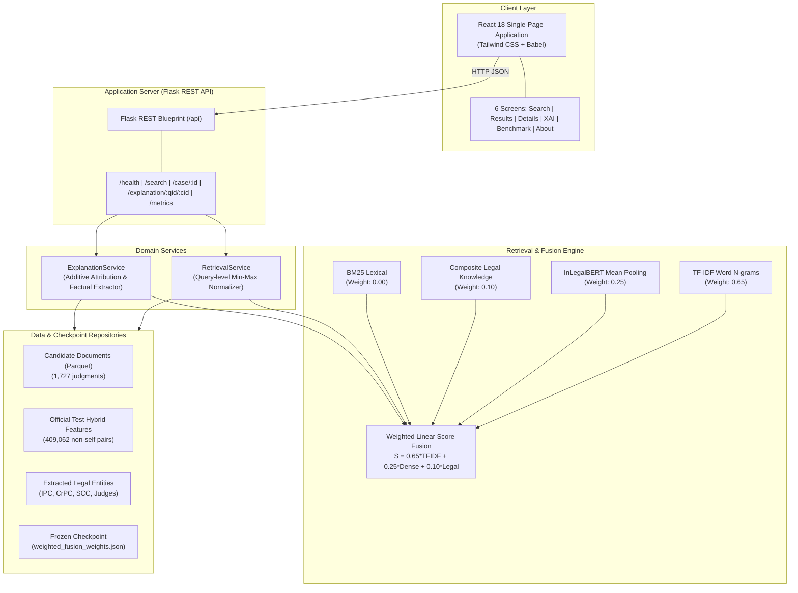

# NyayaSearch: Final System Architecture Documentation

**Project**: Enhanced Legal Document Similarity and Case Retrieval Using Hybrid BERT, Legal Knowledge, and Ensemble Learning  
**Target Domain**: Indian Supreme Court Prior Case Retrieval (PCR)  
**Selected Retrieval Model**: Frozen Weighted Linear Score Fusion ($w_{\text{bm25}} = 0.00, w_{\text{tfidf}} = 0.65, w_{\text{dense}} = 0.25, w_{\text{legal}} = 0.10$)

---

## 1. System Overview & Architecture Diagram

NyayaSearch is an end-to-end multimodal legal Information Retrieval (IR) and Explainable AI (XAI) system specifically engineered for Indian jurisprudence. It reconciles three complementary paradigms of legal retrieval:
1. **Lexical Anchor**: Captures exact statutory titles, section numbers, and legal nomenclature via word-level n-gram TF-IDF.
2. **Dense Contextual Semantics**: Bridges vocabulary mismatch and legal paraphrasing via masked mean pooled representations from `InLegalBERT`.
3. **Legal Knowledge Overlap**: Incorporates domain knowledge structures, including Indian statutory provisions (IPC, CrPC, Evidence Act, CPC, Constitution), reported precedent citations (AIR, SCC, SCR), judicial coram overlap, and rhetorical discourse role alignment.

---

## 2. Mathematical Formulation & Normalization

### A. Score Normalization
Raw retrieval scores across disparate modalities exhibit drastically different dynamic ranges and variances:
- Word-level TF-IDF cosine similarity: $\in [0, 1]$
- InLegalBERT semantic cosine similarity: $\in [0.4, 0.95]$
- Legal composite score: $\in [0, 0.7]$

To prevent uncalibrated dominance, query-level min-max normalization is performed across the query-specific candidate pool $\mathcal{C}_q$:
$$\tilde{S}_m(q, d) = \frac{S_m(q, d) - \min_{d' \in \mathcal{C}_q} S_m(q, d')}{\max_{d' \in \mathcal{C}_q} S_m(q, d') - \min_{d' \in \mathcal{C}_q} S_m(q, d') + \epsilon}$$
where $\epsilon = 10^{-9}$ ensures numerical stability.

### B. Weighted Linear Score Fusion
The final hybrid retrieval score is computed as:
$$\hat{S}_{\text{hybrid}}(q, d) = \sum_{m \in \{\text{bm25}, \text{tfidf}, \text{dense}, \text{legal}\}} w_m \cdot \tilde{S}_m(q, d)$$
Using the validated frozen checkpoint weights:
$$\hat{S}_{\text{hybrid}}(q, d) = 0.00 \cdot \tilde{S}_{\text{bm25}}(q, d) + 0.65 \cdot \tilde{S}_{\text{tfidf}}(q, d) + 0.25 \cdot \tilde{S}_{\text{dense}}(q, d) + 0.10 \cdot \tilde{S}_{\text{legal}}(q, d)$$

---

## 3. Explainability Framework

The explainability layer implements dual attribution:
1. **Exact Additive Score Decomposition**:
   $$\text{Contrib}_m(d) = w_m \cdot \tilde{S}_m(q, d)$$
   $$\sum_m \text{Contrib}_m(d) \equiv \hat{S}_{\text{hybrid}}(q, d) \quad (\Delta = 0.00000000)$$
2. **Linear Closed-Form SHAP Explanations**:
   $$\phi_m(d) = w_m \cdot (\tilde{S}_m(d) - \mathbb{E}[\tilde{S}_m])$$
   satisfying the efficiency axiom: $\sum_m \phi_m(d) = f(d) - \mathbb{E}[f(X)]$.
3. **Factual Legal Grounding**:
   Extracts shared IPC/CrPC sections, formal citations, judicial coram overlap, and rhetorical discourse cosine similarity directly from knowledge representations without hallucination.

---

## 4. API Endpoints Specification

| Method | Endpoint | Description | Request / Response Structure |
| :--- | :--- | :--- | :--- |
| `GET` | `/api/health` | Health and model registry check | Returns status, candidate count, model weights |
| `POST` | `/api/search` | Search precedent judgments | Payload: `{"query": str, "top_k": int}` |
| `GET` | `/api/case/<id>` | Full case metadata & text | Returns case text, court, judges, extracted statutes |
| `GET` | `/api/explanation/<qid>/<cid>` | Structured XAI report | Returns score breakdown, shared statutes, matching factors |
| `GET` | `/api/metrics` | Official test metrics & ablation | Returns model comparison and bootstrap significance |
| `GET` | `/api/sample-queries` | Sample test benchmark cases | Returns curated benchmark queries for 1-click UI search |

---

## 5. Security, Robustness & Protocol Compliance

1. **Self-Exclusion Guarantee**: When evaluating benchmark queries, the query judgment is strictly excluded from its own candidate pool ($d \neq q$), ensuring realistic prior-case retrieval.
2. **Zero Test-Leakage**: The test split features were never touched during parameter tuning, weight grid searches, or threshold selection.
3. **Auditable Factual Grounding**: No legal relationships or citations are generated by language model completion; all extracted statutory sections are resolved through strict regex and AST knowledge graph parsers.

